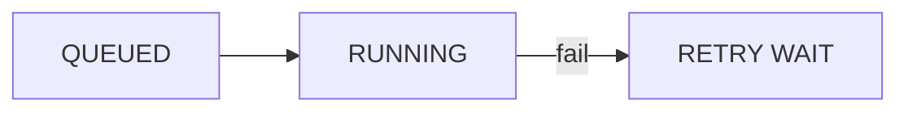

# slidev-theme-swiss-print

A brutalist Swiss print theme for [Slidev](https://sli.dev): paper, ink, one red accent, 1px rules, zero radius,
halftone photos. Light and dark. Every Slidev built-in layout is covered, plus `bullets`, `code`,
`diagram` and `mermaid`.

| Light | Dark |
| --- | --- |
|  |  |
|  |  |
|  |  |
|  |  |
|  |  |
|  |  |
|  |  |
|  |  |

Browse the whole demo deck at [rlemaitre.github.io/slidev-templates](https://rlemaitre.github.io/slidev-templates/).

## Install

```bash
npm install -D slidev-theme-swiss-print
```

```yaml
---
theme: swiss-print
colorSchema: light # or dark: pick one per talk
---
```

Fonts (Archivo, Atkinson Hyperlegible Next, JetBrains Mono) are bundled, so talks and PDF exports work offline.

## Metadata

Everything personal or talk-specific comes from metadata, on three levels. The most specific wins:

1. theme defaults (a fake speaker, so a new deck renders with no setup),
2. the deck's `themeConfig` in the headmatter,
3. the same keys in one slide's frontmatter.

Objects merge per key (`speaker: { role: Keynote }` keeps the name). Lists (`links`, `sections`) are replaced whole.

```yaml
---
theme: swiss-print
themeConfig:
  speaker:
    name: Sam Doe
    role: Staff engineer
    portrait: /sam.jpg
  event: DevConf 2027
  location: Lyon
  date: 2027-05-20
  website: sam.example
  handle: '@sam.example'
  slidesUrl: sam.example/talks/queues
  links:
    - { label: Web, value: sam.example }
    - { label: GitHub, value: sam-doe }
---
```

| Key | Used by | Default |
| --- | --- | --- |
| `speaker.name` | top bar, cover | `Alex Martin` |
| `speaker.role` | cover | `Platform engineer` |
| `speaker.portrait` | cover, `image-*` without `image` | a Slidev cover photo |
| `event`, `location`, `date` | top bar (`event`), cover | empty |
| `website`, `handle` | footer, cover | `alex.example`, `@alex.example` |
| `slidesUrl` | `end`: URL and QR code (hidden when empty) | empty |
| `links` | `end`: readable handles, `{ label, value }` | fake speaker's handles |
| `sections` | `section` agenda row | built from the deck's `section` slides |
| `frame` | framed layouts: `false` hides top bar and footer | `true` |

## Layouts

The first `#` heading of a slide is its display title; `*word*` puts that word in red.

| Layout | Frontmatter | Notes |
| --- | --- | --- |
| `cover`, `intro` | `subtitle` | Big title, halftone portrait, speaker and meta row |
| `section` | `number` | Big red number, agenda row with the current section inverted |
| `statement` | `kicker` | Huge display line at the bottom |
| `fact` | `kicker`, `caption` | Big value with a mono caption |
| `quote` | `cite` | Display quote and attribution |
| `bullets` | `kicker` | Title left, numbered list right (see below for highlights) |
| `code` | `figure` | Title left with `Fig. NN / Code`, code block right |
| `diagram` | | Title, then HTML boxes (`.flow`, `.box`, `.box.hot`, `.arrow`) |
| `mermaid` | | Title, then a Mermaid diagram that fills the free area |
| `default`, `center` | | Framed; plain Markdown (tables, quotes, inline code) is styled |
| `two-cols`, `two-cols-header` | | Framed columns split by a 2px rule (`::right::`, `::left::`) |
| `full` | | No frame, the whole slide |
| `image-left`, `image-right` | `image`, `caption`, `imagePosition`, `kicker` | Halftone photo on one half, text on the other |
| `image` | `image`, `caption`, `imagePosition`, `number`, `title`, `titleStyle` | Fullscreen photo; optional title on a paper `panel` (default) or an `overlay` box |
| `iframe`, `iframe-left`, `iframe-right` | `url`, `kicker` | A live web page instead of a photo |
| `none` | | Slidev's own, unstyled |

### Highlights: the `hot` class

One word marks the thing that matters, everywhere:

```html
<ol>
  <li>When a queue helps</li>
  <li class="hot">Backpressure</li>
</ol>

<div class="flow">
  <div class="box"><span class="sp-mono">01</span><b>Producer</b></div>
  <div class="arrow">→</div>
  <div class="box hot"><span class="sp-mono">02</span><b>Queue</b></div>
</div>
```

In Mermaid flowcharts, mark a node with `class X hot` and an edge by giving it an id:

````md

````

The theme renders Mermaid itself so diagrams match the design in both color schemas. Your own `setup/mermaid.ts`
still applies on top (for example `securityLevel: 'loose'` or extra `themeVariables`).

### Photos

`image` takes an absolute URL or a path in your deck's `public/` folder (`/photo.jpg`). Every photo gets the grayscale
and halftone treatment. `imagePosition` sets the crop focus (default `50% 30%`).

## Demo

See every layout at [rlemaitre.github.io/slidev-templates](https://rlemaitre.github.io/slidev-templates/). The source
is `example/slides.md`; run `npm run dev` in this repo to edit it live.

## Releases

Commits on `main` follow [Conventional Commits](https://www.conventionalcommits.org). release-please keeps a release
pull request open with the next version and the changelog; merging it tags the release and publishes it to npm with
provenance.

## Credits

Design and theme by Raphaël Lemaitre, based on the design of [rlemaitre.com](https://rlemaitre.com). Demo photos come
from [Slidev's curated covers](https://sli.dev/resources/covers); photographers are credited in
[`example/README.md`](example/README.md).

## License

MIT
