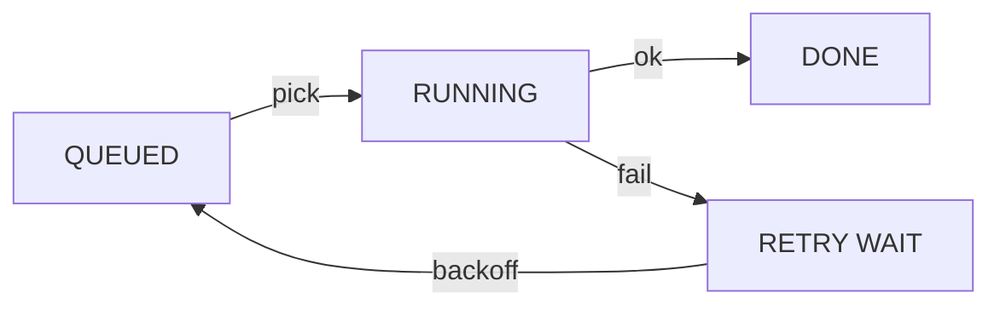
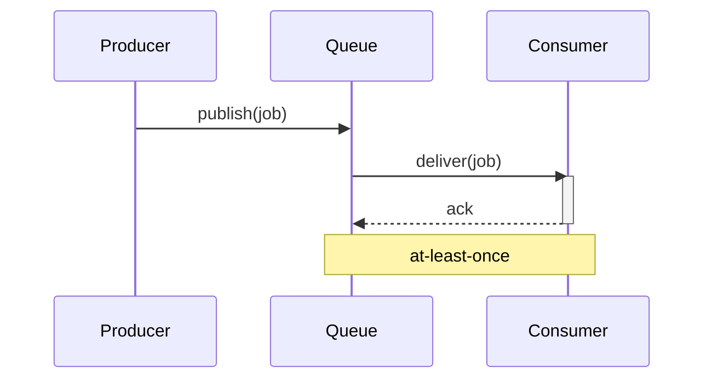

# Queues are not *magic*.

---
layout: default
---

# Hello *world*

---

# Plain *Markdown*

A paragraph with `inline code`.

> A queue is a buffer with opinions.

| Queue | Delivery |
| --- | --- |
| SQS | at least once |
| Kafka | at least once |

---
layout: default
event: ''
---

# No *event* on this slide

---
layout: default
frame: false
---

# No *frame*

---
layout: full
---

# Full *bleed*

---
layout: center
---

# *Centered*

---
layout: two-cols
---

# Left *column*

::right::

Right

---
layout: two-cols-header
---

# Column *header*

::left::

Left side

::right::

Right side

---
layout: cover
date: ''
---

# No date here

---
layout: intro
---

# Intro *layout*

---
layout: section
---

# Why *queues*

---
layout: section
---

# Back *pressure*

---
layout: section
---

# *Retries*

---
layout: section
---

# *Costs*

---
layout: end
---

---
layout: end
slidesUrl: ''
---

---
layout: statement
kicker: — The point
---

# Latency is a *feature*.

---
layout: fact
kicker: — In production
caption: messages per second at peak, one consumer group
---

# 40*k*

---
layout: quote
cite: Every on-call engineer, eventually
---

# A queue is a buffer with *opinions*.

---
layout: bullets
kicker: — Agenda
---

# What we'll *cover*

<ol>
  <li>When a queue actually helps</li>
  <li class="hot">Backpressure, or why queues fill up</li>
  <li>Retries without duplicates</li>
  <li>What it costs to run</li>
</ol>

---
layout: bullets
---

# Plain *list*

- Producers publish
- Consumers acknowledge
- Brokers redeliver

---
layout: code
figure: '04'
---

# Retry with *backoff*

```ts
type Job = { id: string; attempts: number }

const MAX_ATTEMPTS = 5

function delay(job: Job): number {
  // 1s, 2s, 4s, 8s, 16s
  return 1000 * 2 ** job.attempts
}
```

---
layout: code
figure: '05'
---

# Same in *Scala*

```scala
final case class Job(id: String, attempts: Int)

val MaxAttempts = 5

def delay(job: Job): Long =
  // 1s, 2s, 4s, 8s, 16s
  1000L * math.pow(2, job.attempts).toLong
```


---
layout: diagram
---

# Where the *time* goes

<div class="flow">
  <div class="box"><span class="sp-mono">01</span><b>Producer</b></div>
  <div class="arrow">→</div>
  <div class="box hot"><span class="sp-mono">02 · 80%</span><b>Queue</b></div>
  <div class="arrow">→</div>
  <div class="box"><span class="sp-mono">03</span><b>Consumer</b></div>
</div>

---
layout: mermaid
---

# Job *lifecycle*



---
layout: mermaid
---

# Who calls *whom*



---
layout: image-left
image: https://cdn.jsdelivr.net/gh/slidevjs/slidev-covers@main/static/9jFPVQzUgNY.webp
caption: Fig. 02 / Santorini
kicker: — Interlude
---

# Step *back.*

---
layout: image-right
image: https://cdn.jsdelivr.net/gh/slidevjs/slidev-covers@main/static/9jFPVQzUgNY.webp
caption: Fig. 03 / Santorini
---

# Mirror *image*

---
layout: image
image: https://cdn.jsdelivr.net/gh/slidevjs/slidev-covers@main/static/3GmudSL84n4.webp
caption: Fig. 05 / Monte Pelmo
---

---
layout: image
image: https://cdn.jsdelivr.net/gh/slidevjs/slidev-covers@main/static/3GmudSL84n4.webp
caption: Fig. 05 / Monte Pelmo
number: '03'
title: Above the *clouds*
---

---
layout: image
image: https://cdn.jsdelivr.net/gh/slidevjs/slidev-covers@main/static/3GmudSL84n4.webp
caption: Fig. 05 / Monte Pelmo
number: '03'
title: Above the *clouds*
titleStyle: overlay
---

---
layout: image
image: /local.webp
caption: Fig. 06 / Local file
---

---
layout: iframe-left
url: https://example.com
---

# Live *demo*

---
layout: iframe-right
url: https://example.com
kicker: — Try it
---

# Embedded *page*

---
layout: iframe
url: https://example.com
---
